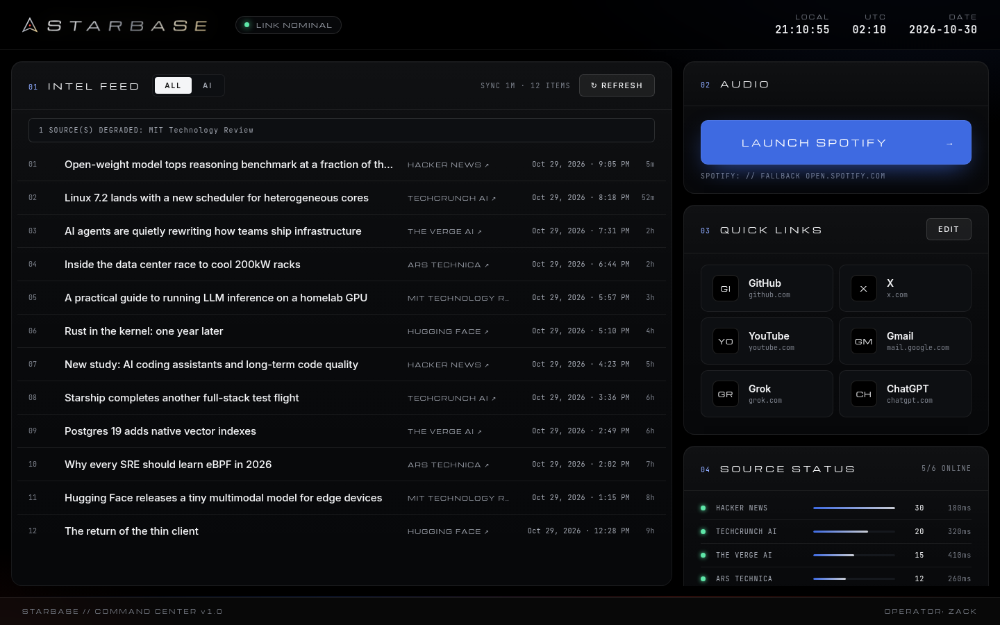
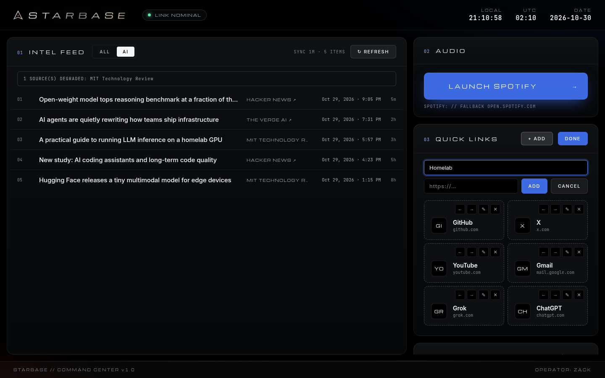
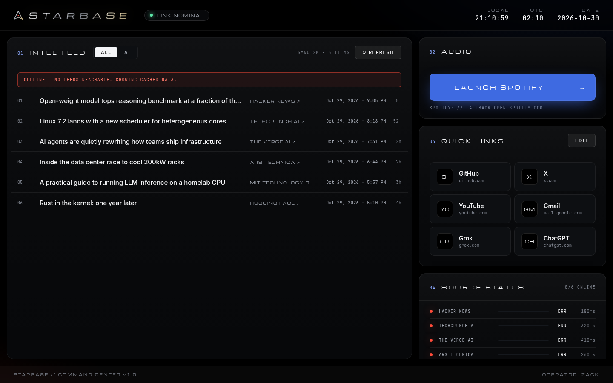
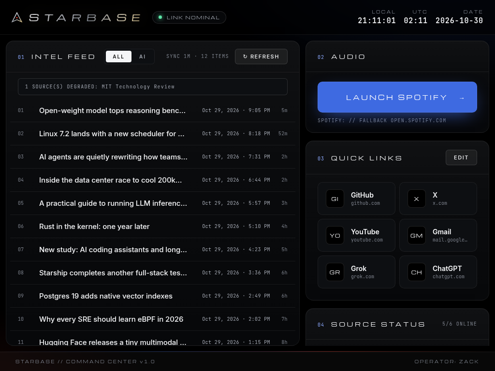

<p align="center"></p>

<p align="center"><b>Mission control for one. Pure black, zero clutter, all signal.</b></p>

<p align="center">
  
  
  
  
  
  
  
</p>

<p align="center">
  <a href="#overview">Overview</a> &nbsp;·&nbsp; <a href="#features">Features</a> &nbsp;·&nbsp; <a href="#screenshots">Screenshots</a> &nbsp;·&nbsp;
  <a href="#tech-stack">Tech stack</a> &nbsp;·&nbsp; <a href="#getting-started-dev-setup">Getting started</a> &nbsp;·&nbsp; <a href="#install-windows-11">Install</a> &nbsp;·&nbsp; <a href="docs/TESTING.md">Testing</a>
</p>

<p align="center"></p>

## Overview

STARBASE is a personal command center for a Linux/infrastructure engineer who happens to sit in front of a
Windows 11 box. Open it and you get the day's AI and tech headlines, your go-to sites, and a big button that
starts the music. Then you get back to work.

It's a single portable `.exe`, so there's no installer and no account to make. It never asks you for an API key.

---


## Features

| # | System | What it does |
|---|--------|--------------|
| 01 | **Intel Feed** | Merges AI and tech news from Hacker News (official Firebase API), TechCrunch AI, The Verge AI, Ars Technica, MIT Technology Review and the Hugging Face blog. Drops duplicates and sorts newest first. Each row shows the title (click it to open the article), the source name (click it to open that publication's site, or the HN discussion for Hacker News items), and the publish date in local time, like `Oct 29, 2026 · 7:42 PM`, with a relative age next to it. An **ALL / AI** toggle filters the list to AI topics.  Every link opens in your default browser. |
| 02 | **Audio** | A large **LAUNCH SPOTIFY** button. It hands off to the Spotify desktop app through the `spotify:` URI. If that fails, it opens https://open.spotify.com. |
| 03 | **Quick Links** | A tile grid for the sites you use most. Defaults are GitHub, X, YouTube, Gmail, Grok and ChatGPT. Under **EDIT** you can add, rename, re-point, reorder (drag or ← →) and delete tiles. Everything persists locally. |
| 04 | **Source Status** | Shows live status for each feed: online/error, item count and latency, so you can see which source is down. |
| ⏱ | **Clocks** | Local time, UTC and an ISO date. |
| ↻ | **Refresh** | Manual refresh plus auto-refresh every 15 minutes. Feeds fail independently, and if the whole network is out you get an *OFFLINE* banner with cached headlines. The app doesn't crash. |

**Design notes:** pure `#000` canvas with restrained launch-blue `#3E6AE1` and ignition-red `#FF4B3A` glows. The wordmark and section titles use
**Michroma**, a wide geometric display face, letter-spaced in uppercase. The wordmark has a metallic silver-to-gold gradient. Body text uses **Inter**, and data uses **JetBrains Mono**.
All three fonts are bundled locally through Fontsource, so nothing loads from a CDN. Their SIL OFL licenses are in [`docs/licenses/`](docs/licenses).
Panels are rounded and glassy, the primary buttons are solid blue, and focus rings are visible. Motion is limited to a scan bar while syncing, staggered rows and a pulsing equalizer, and it switches off under `prefers-reduced-motion`.

**Security posture:** `contextIsolation: true`, `nodeIntegration: false`, `sandbox: true`, and a strict CSP.
The preload exposes five IPC calls and nothing else. Only `http:`, `https:` and `spotify:` URLs are allowed out to `shell.openExternal`.
In-app navigation and `window.open` are blocked and sent to the default browser. All network fetches run in the main process, so CORS doesn't come into it.


---

## Screenshots

| Main console | AI filter + quick-link editor |
|---|---|
|  |  |
| **Offline banner with cached headlines** | **Compact window (1024 px)** |
|  |  |

<sub>Rendered with sample data.</sub>

## Tech stack

| Layer | Tools |
|---|---|
| Shell | Electron 45 (context-isolated, sandboxed renderer) |
| UI | React 19, TypeScript (strict), Vite, plain CSS design tokens |
| Feeds | `fast-xml-parser` in the main process |
| Type | Michroma · Inter · JetBrains Mono (Fontsource, bundled offline) |
| Tests | Vitest |
| Packaging | electron-builder (NSIS + portable), GitHub Actions |

---

## Getting started (dev setup)

Requires Node.js 20+ (built and tested on 24) and npm.

```bash
T-3  git clone <your-remote>/starbase.git && cd starbase
T-2  npm install
T-1  npm run dev        # Vite dev server + Electron with live renderer reload
T-0  🔥
```

### Scripts

| Command | Purpose |
|---------|---------|
| `npm run dev` | Dev mode (Vite on :5173 + Electron) |
| `npm run build` | Compile main/preload (`tsc`) and renderer (`vite build`) |
| `npm start` | Run the built app |
| `npm test` | Vitest unit tests (feed parsing, entity decoding, URL allow-list, link sanitizing) |
| `npm run typecheck` | Strict TypeScript across renderer, main and preload |
| `npm run icons` | Regenerate `build/icon.png` + `build/icon.ico` from `build/icon.svg` |
| `npm run dist:win` | Build the Windows x64 installer + portable exe into `release/` |

> **Linux note:** if `node_modules/electron/dist` is missing after install (newer npm versions can hold back install scripts), run `node node_modules/electron/install.js`.

## Install (Windows 11)

**1. Get the binaries.** Open [Releases](https://github.com/Zanick777/STARBASE/releases/latest) and download one of these:

| File | Pick it if… |
|------|-------------|
| `STARBASE-Setup.exe` | You want a normal installed app: Start Menu + desktop shortcut, a listing in *Installed apps*, and a clean uninstall. The installer asks where to install (default is per-user, no admin needed). |
| `STARBASE.exe` | You want **portable**: no install, nothing in Start Menu. Put it anywhere (Desktop, a USB stick) and double-click. The first launch takes a few seconds while it unpacks to a temp folder. |

**2. Clear SmartScreen.** The binaries aren't code-signed, so Windows will show *"Windows protected your PC"*.
Click **More info → Run anyway**. You only need to do this once per downloaded file. If Edge blocks the download itself, open the download menu (**…**), choose **Keep**, then **Show more → Keep anyway**.

**3. Liftoff.** Launch STARBASE. Headlines load within seconds when you're online.

**Where your settings live:** `%APPDATA%\STARBASE\quicklinks.json`. That folder is shared by the installer and portable builds, so switching between them keeps your tiles.

**Uninstall:**
- *Installer build:* go to **Settings → Apps → Installed apps → STARBASE → ⋯ → Uninstall**, or use *Uninstall STARBASE* in the Start Menu.
- *Portable build:* delete `STARBASE.exe`.
- Either way, your settings are kept on purpose. For a full wipe, also delete `%APPDATA%\STARBASE`.

**No accounts, no cloud.** STARBASE has no login, telemetry, analytics, auto-updater or backend. Its only network traffic is HTTPS GETs to the public news feeds listed above, plus whatever links you click, which open in your browser.

## Building the Windows .exe

### Locally (Windows, macOS or Linux)
```bash
npm run dist:win
# → release/STARBASE-Setup.exe  (NSIS installer, x64)
# → release/STARBASE.exe        (portable, x64)
```
On Windows this needs nothing extra. On Linux or macOS the **portable** target builds natively (`npx electron-builder --win portable --x64`), but the **NSIS installer** needs Wine, because electron-builder runs it to generate the uninstaller. If you don't have Wine, let CI build it.
The binary is **unsigned**, so the first time you run it Windows SmartScreen will warn you. Click *More info → Run anyway*.

### Via GitHub Actions
`.github/workflows/build-windows.yml` runs on `windows-latest` for every push to `main`, every `v*` tag, and manual dispatch.
It typechecks, tests, builds and uploads `STARBASE-Setup.exe` and `STARBASE.exe` as the **STARBASE-windows-x64** artifact.
When you push a tag, it also attaches both exes to a GitHub Release:
```bash
git tag v1.0.0 && git push origin v1.0.0
```

## Where settings live

Quick links are stored as JSON in Electron's `userData` directory and written atomically:

| OS | Path |
|----|------|
| Windows | `%APPDATA%\STARBASE\quicklinks.json` |
| Linux | `~/.config/STARBASE/quicklinks.json` |
| macOS | `~/Library/Application Support/STARBASE/quicklinks.json` |

Delete the file to go back to the default tiles. News isn't written to disk. The last good fetch is kept in memory as the offline fallback.

## Project structure
```
src/main/       Electron main: window, IPC, feed fetching, link storage
src/preload/    contextBridge → window.starbase (5 methods)
src/shared/     Pure, tested logic: feed parsing, URL rules, link sanitizing
src/renderer/   React UI (NewsFeed, QuickLinks, SpotifyLauncher, Telemetry = source status)
docs/           Screenshots, banner, font licenses + TESTING.md (what's verified where)
build/          App icon (svg / png / ico)
tests/          Vitest suite
```

## Roadmap

- [x] **v1.0 — First light.** News feed with publish dates and source links, editable quick links, Spotify launcher, source status, Windows installer + portable build, CI.
- [ ] Configurable feed list (add your own RSS from inside the app)
- [ ] Global hotkey to summon STARBASE
- [ ] Favicons on quick-link tiles (cached locally)
- [ ] System tray + launch on startup
- [ ] Homelab panel: ping and health-check your own servers

## Known limitations
- Windows verification status is tracked in [docs/TESTING.md](docs/TESTING.md).
- The exe is unsigned, so SmartScreen will warn on first run.
- On Windows, `spotify:` reports success whenever *any* handler is registered. The web fallback only kicks in when the OS rejects the URI.
- Feed URLs are public and could change. If one breaks, Telemetry flags it and the other sources keep working.
