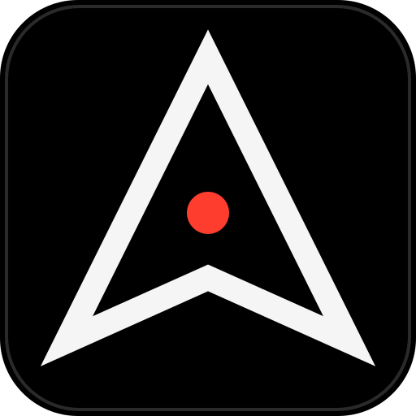
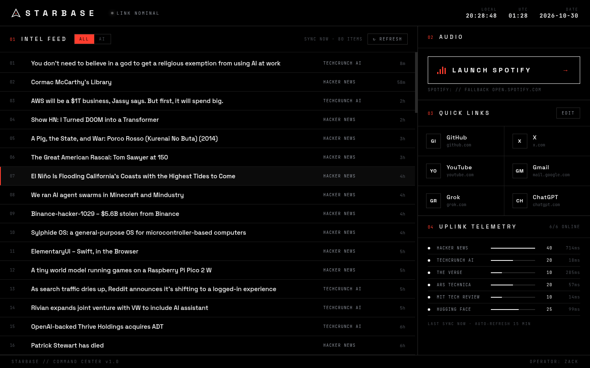
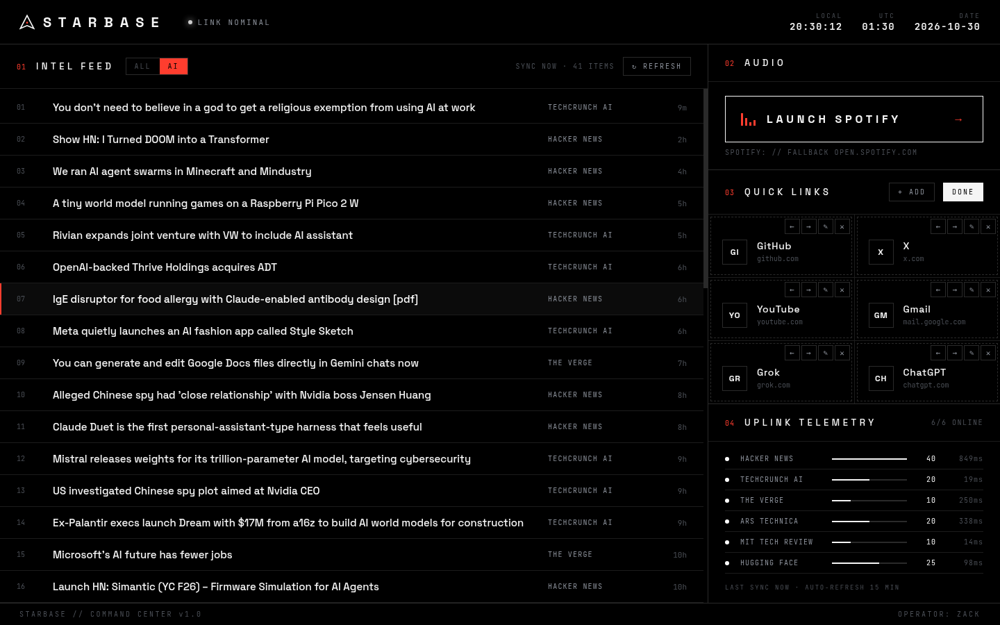

<p align="center"></p>
<h1 align="center">S T A R B A S E</h1>
<p align="center"><b>Mission control for one. Pure black, zero clutter, all signal.</b></p>

<p align="center">
  
  
  
  
  
  
</p>

<p align="center"></p>

STARBASE is a personal command center for a Linux/infrastructure engineer who happens to sit in front of a
Windows 11 box. Open it and you get the day's AI and tech headlines, your go-to sites, and a big button that
starts the music. Then you get back to work.

It's a single portable `.exe`, so there's no installer and no account to make. It never asks you for an API key.

---

## 🛰 Flight Systems

| # | System | What it does |
|---|--------|--------------|
| 01 | **Intel Feed** | Merges AI and tech news from Hacker News (official Firebase API), TechCrunch AI, The Verge AI, Ars Technica, MIT Technology Review and the Hugging Face blog. Drops duplicates and sorts newest first. Each row shows title, source and relative time. An **ALL / AI** toggle filters the list to AI topics. Click a headline to open it in your default browser. |
| 02 | **Audio** | A large **LAUNCH SPOTIFY** button. It hands off to the Spotify desktop app through the `spotify:` URI. If that fails, it opens https://open.spotify.com. |
| 03 | **Quick Links** | A tile grid for the sites you use most. Defaults are GitHub, X, YouTube, Gmail, Grok and ChatGPT. Under **EDIT** you can add, rename, re-point, reorder (drag or ← →) and delete tiles. Everything persists locally. |
| 04 | **Uplink Telemetry** | Shows live status for each feed: online/error, item count and latency, so you can see which source is down. |
| ⏱ | **Clocks** | Local time, UTC and an ISO date. |
| ↻ | **Refresh** | Manual refresh plus auto-refresh every 15 minutes. Feeds fail independently, and if the whole network is out you get an *OFFLINE* banner with cached headlines. The app doesn't crash. |

**Design notes:** pure `#000` background, white and cool-grey type, and one accent color, ignition red `#ff3d2e`.
It uses Space Grotesk for display text and JetBrains Mono for data. Both fonts are bundled locally through Fontsource, so nothing loads from a CDN.
Borders are 1px. Motion is limited to a scan bar while syncing, staggered rows and an equalizer that pulses.

**Security posture:** `contextIsolation: true`, `nodeIntegration: false`, `sandbox: true`, and a strict CSP.
The preload exposes five IPC calls and nothing else. Only `http:`, `https:` and `spotify:` URLs are allowed out to `shell.openExternal`.
In-app navigation and `window.open` are blocked and sent to the default browser. All network fetches run in the main process, so CORS doesn't come into it.

<p align="center"><br><sub>AI filter engaged, quick links in edit mode.</sub></p>

---

## 🚀 Launch Sequence (dev setup)

Requires Node.js 20+ (built and tested on 24) and npm.

```bash
T-3  git clone <your-remote>/starbase.git && cd starbase
T-2  npm install
T-1  npm run dev        # Vite dev server + Electron with live renderer reload
T-0  🔥
```

| Command | Purpose |
|---------|---------|
| `npm run dev` | Dev mode (Vite on :5173 + Electron) |
| `npm run build` | Compile main/preload (`tsc`) and renderer (`vite build`) |
| `npm start` | Run the built app |
| `npm test` | Vitest unit tests (feed parsing, entity decoding, URL allow-list, link sanitizing) |
| `npm run typecheck` | Strict TypeScript across renderer, main and preload |
| `npm run icons` | Regenerate `build/icon.png` + `build/icon.ico` from `build/icon.svg` |
| `npm run dist:win` | Build the Windows x64 portable `release/STARBASE.exe` |

> **Linux note:** if `node_modules/electron/dist` is missing after install (newer npm versions can hold back install scripts), run `node node_modules/electron/install.js`.

## 🏗 Stage Separation (building the Windows .exe)

### Locally (Windows, macOS or Linux)
```bash
npm run dist:win
# → release/STARBASE.exe  (portable, x64, no installer)
```
This also works on Linux, and Wine isn't needed. electron-builder runs NSIS and edits the exe resources natively.
The binary is **unsigned**, so the first time you run it Windows SmartScreen will warn you. Click *More info → Run anyway*.

### Via GitHub Actions
`.github/workflows/build-windows.yml` runs on `windows-latest` for every push to `main`, every `v*` tag, and manual dispatch.
It typechecks, tests, builds and uploads `STARBASE.exe` as the **STARBASE-windows-x64** artifact.
When you push a tag, it also attaches the exe to a GitHub Release:
```bash
git tag v1.0.0 && git push origin v1.0.0
```

## 💾 Black Box (where settings live)

Quick links are stored as JSON in Electron's `userData` directory and written atomically:

| OS | Path |
|----|------|
| Windows | `%APPDATA%\STARBASE\quicklinks.json` |
| Linux | `~/.config/STARBASE/quicklinks.json` |
| macOS | `~/Library/Application Support/STARBASE/quicklinks.json` |

Delete the file to go back to the default tiles. News isn't written to disk. The last good fetch is kept in memory as the offline fallback.

## 🗺 Project Layout
```
src/main/       Electron main: window, IPC, feed fetching, link storage
src/preload/    contextBridge → window.starbase (5 methods)
src/shared/     Pure, tested logic: feed parsing, URL rules, link sanitizing
src/renderer/   React UI (NewsFeed, QuickLinks, SpotifyLauncher, Telemetry)
build/          App icon (svg / png / ico)
tests/          Vitest suite
```

## 📡 Mission Log

- [x] **v1.0 — First light.** News feed, quick links, Spotify launcher, telemetry, portable Windows build, CI.
- [ ] Configurable feed list (add your own RSS from inside the app)
- [ ] Global hotkey to summon STARBASE
- [ ] Favicons on quick-link tiles (cached locally)
- [ ] System tray + launch on startup
- [ ] Homelab panel: ping and health-check your own servers

## Known limitations
- The exe is unsigned, so SmartScreen will warn on first run.
- On Windows, `spotify:` reports success whenever *any* handler is registered. The web fallback only kicks in when the OS rejects the URI.
- Feed URLs are public and could change. If one breaks, Telemetry flags it and the other sources keep working.
